# DSH 实时轨迹分析：可执行计划 v2

> 状态：**执行中；Canonical Trajectory v1、DSH 离线归一化与首批工具/压缩 reducer 已落地；aeval 已生成 3 组生命周期 golden。DSH projection 已增量计算对应指标，但 fixture parity gate、完整 Team 子树投影和分析 UI 尚未落地。**
> 目标用户：安装 `dsh-eval-control` 的普通 DSH 用户；无需安装 aeval 或配置 broker。
> 共享指标语义、规范化模型和 golden fixture 的权威归属在 aeval；插件侧设计/接入说明见 [`trajectory-metrics-contract.md`](trajectory-metrics-contract.md)、[`trajectory-normalization-fixture-contract.md`](trajectory-normalization-fixture-contract.md)，DSH 原始字段映射见 [`trajectory-field-metric-span-map.md`](trajectory-field-metric-span-map.md)。如插件副本与 aeval 正式契约不一致，以锁定的 aeval commit 为准。
> 本文替代旧计划作为后续实施入口。旧文件保留作侦察与设计历史，不再作为验收标准。

## 执行清单（按提交顺序）

本清单是本轮“完成 DSH 侧个人轨迹分析”的具体执行顺序。每阶段先完成实现与验收，再分别提交并推送 aeval/插件仓库中属于该阶段的改动；若某阶段依赖 DSH 0.2.0-rc.2 未提供的运行时事实，必须将该指标实现为明确 `unavailable` 并附数据质量原因，不得伪造值。

| 阶段 | 目标 | 验收门槛 | 状态 |
| --- | --- | --- | --- |
| S0 计划与边界冻结 | 按 §5/§6 定义本轮顺序；确认单会话、跨会话、UI 三类交付边界 | 计划可逐项勾选；每阶段有可验证产物 | 进行中 |
| S1 共同语义与 parity gate | aeval fixture 为权威；插件能消费同一 fixture，对实时前缀输出与 Python 期望逐字段比较；覆盖空会话、闭合/开放、surface replacement、重复/孤立端点 | 自动差异报告覆盖 value/unit/status/分母/evidence/quality；来源 revision 与 manifest hash 被记录 | 待开始 |
| S2 单会话事件指标 | 在 projection 上增量提供工具错误/重试/重复、压缩规模/频率/时间、模型重试与流式边界、inbox/工具 overlap、计划变化、长间隔及覆盖质量 | 指标契约中每个 DSH 0.2.0-rc.2 可支持指标有实时值、状态、证据引用；缺证据指标明确 unavailable；checkpoint/reload 不重复计数 | 待开始 |
| S3 Team 子树聚合 | 发现授权子 session 并聚合成员 busy/idle/unknown、并发、投递、阻塞时长、首活动间隔、完成跨度和显式依赖关键链 | 使用多层子树 fixture；跨 session 每项共同指标逐字段通过 S1；订阅/授权/卸载生命周期有确定行为 | 待开始 |
| S4 普通用户分析页 | 在官方 Trajectory 并列入口；计数/趋势首页；点击指标展开白名单事件明细并跳转/降级定位 | 普通 profile 无 aeval broker 可见；工具名/任务标题可读；敏感载荷默认不出 projection；每种证据落点有验证矩阵 | 待开始 |
| S5 发布验收 | 精确 pin DSH 0.2.0-rc.2；跑 TS/Python parity、静态检查、插件构建和必要回归；更新文档/changelog | 本计划 §10 验收项通过；按阶段提交推送，最终摘要列出未支持项和 commit | 待开始 |

执行约束：阶段提交应聚焦单一交付面；提交后立即推送对应仓库，并记录远端分支/commit。任何依赖 UI 宿主 API 或 DSH runtime API 的实现先从锁定版本源码/类型确认能力，不以猜测接口代替验收。

## 1. 目标与范围

为普通 DSH 用户提供一个与官方 Trajectory 并列的会话分析页：会话进行时显示计数和趋势；用户点击某个指标后查看有限、可核查的事件明细，并尽可能跳到官方 Trajectory 定位原始调用。分析范围是当前会话及其沿 DSH 父子血缘派生、且当前用户有权访问的子会话。

实时插件（TypeScript）和 aeval 离线复算（Python）使用同一份指标契约、同一规范化模型和同一套 fixture。相同 DSH 版本与输入事件必须对所有共同指标逐字段一致；实时状态可暂时未闭合，但其状态和值须与离线在相同截断点一致。

本计划不建设第二个全量日志浏览器，不读取/tail 压缩后的 session 文件，不采集或导出完整 prompt/工具参数，不把时间重叠解释成因果，也不从 turn completed 推断任务成功。

## 2. 产品行为

### 2.1 默认视图

- 分析页默认只展示当前会话及已发现子树的**计数、按 turn/时间顺序的趋势和状态摘要**；不默认展示消息正文、工具参数或绝对路径。
- Team 区域展示成员状态分布、当前并发数/峰值、任务板状态、显式依赖等待和团队时间线。
- 未知类型、未配对关系、未闭合 Span 和版本不支持项显示为数据覆盖/完整性状态，不作为零值。
- 单会话样本不足时显示计数、当前值、趋势，不显示误导性分位数；样本量和覆盖范围始终可见。

### 2.2 点击后的明细

点击指标后，在分析页展开有界证据卡片（默认最多 5 个相关事件或按组折叠），至少包含：事件类型、时间、工具名/任务标题/成员名等安全摘要、所属 session、turn/step/task 标识、证据等级、关联依据和原始事件引用。

只从事件中已存在的字段生成摘要：工具名来自 `tool/call.name`，任务标题来自 `team/task.task.subject`；消息内容、参数、文件路径等敏感载荷默认不展示。原文查看仅在用户显式展开且 DSH 权限允许时提供。

“跳到官方 Trajectory”按能力诚实降级：

1. 有官方 focus 描述符（当前已知为工具调用 `callId`）时，切换到 Trajectory 并定位该调用。
2. 只有 session/seq 引用而无 focus API 时，打开对应 session 的 Trajectory 页面并展示可复制的 seq 和事件摘要；不宣称已高亮。
3. 跨子会话证据先切换到对应且已授权的子会话，再执行 1/2；不可访问时显示原因，不泄露内容。

验收时须逐事件类型记录跳转能力矩阵，不能只验证工具调用后宣称所有证据都可定位。

## 3. 数据架构

采用 DSH 官方机制，不 tail `session.v4.jsonl.zstd`：

1. **会话投影**：每个 session 的 `trajectoryAnalytics` projection 同步折叠已提交事件，计算本会话指标和有界证据句柄。
2. **宿主侧子树聚合器**：发现当前根 session 的可访问后代 session，订阅其生命周期/事件/状态变化，维护跨会话成员状态、并发和 Team 关系。
3. **客户端分析页**：通过 projection wire view 读取实时聚合；不另写轮询，不请求不必要的原始事件载荷。
4. **aeval 离线复算**：从封存证据中的 DSH 原始/保留事件运行同一规范化与指标语义；共用 fixture 与期望 JSON。

### 3.1 Harbor 评测证据交接（与个人实时分析分开）

评测数据流由 Harbor/aeval 的 trial 生命周期负责封存；analytics projection 不负责导出或上传评测文件：

```mermaid
flowchart LR
  A[aeval 生成 trial 配置与 sandbox Cordis patch] --> B[Harbor sandbox 内运行 DSH]
  B --> C[DSH 官方 session persistence 写事件日志]
  C --> D[Harbor trial 结束并同步 session 目录到 host]
  D --> E[aeval session_reader 调用 DSH 官方 reader]
  E --> F[ATIF 映射并保留 DSH 事件扩展]
  F --> G[构建 canonical_transcript]
  G --> H[写 artifact 并计算 SHA-256]
  H --> I[manifest 引用；后续读取校验 hash]
```

实施时按以下已存在的代码边界接线，不新增从实时面板读取文件的旁路：

1. `aeval/src/aeval/agents/dsh/control_flavor.py::deploy_control_stack` 为 sandbox 准备 eval 配置和专用 `cordis.patch.yml`。该 patch 当前按依赖顺序挂 `sandbox_entry.js`（broker transport）和 `index.js`（eval control）；它不复用普通用户默认 patch，也不需要在 Harbor sandbox 中启用个人分析 UI。
2. DSH 在 sandbox 内通过自己的 session persistence 持久化已提交事件。Harbor/aeval 在 trial 完成后同步 session 目录到 host；aeval 的 `DshAgent._rebuild_canonical_transcript` / `read_session_record` 检查同步结果并调用插件提供的 `dist/session_reader.js`，由 DSH 官方 reader 解析 session，而不是自行解析压缩 JSONL。
3. `aeval/src/aeval/agents/dsh/atif_mapper.py` 将官方 reader 的事件映射为 ATIF，同时把可保留的 DSH 事件放入扩展字段；`aeval/src/aeval/hooks/collection.py::collect_trial_evidence` 汇集证据并调用 `produce_canonical_transcript`。
4. `aeval/src/aeval/hooks/collectors.py::produce_canonical_transcript` 持久化 canonical transcript，生成 `ArtifactRef`（含 SHA-256）；证据 manifest 登记 artifact，`hooks/evidence.py` 等读取边界重算并核对哈希。

因此“封存”是**trial 结束后的 host-side 收集、规范化、artifact 写入与完整性校验**，不是要求插件在 sandbox 运行中 tail/复制压缩 session 文件。在线展示依赖 DSH projection；离线评测依赖已同步的官方 session 与 canonical artifact。两者可以消费相同事件语义，但生命周期、传输通道和数据目录分离。任何未来的在线 telemetry 上传都是独立功能，不能隐式复用 aeval broker 或评测配置。

### 3.2 插件入口与配置隔离

- `sandbox_entry.js` / `index.js` 保持 aeval 专用：前者接入 broker，后者读取已校验的评测配置、绑定 run/session lineage 并完成评测观测封存。
- 新增 `analytics_entry.js`，只注入 DSH `sessionProjections` service 并注册 `trajectoryAnalytics` 投影。它不注入 `evalBroker`、不读取 `AEVAL_CONTROL_CONFIG`、不处理评测 token 或 bundle 路径。
- 普通用户默认 profile 可以挂载 analytics；没有评测配置时 transport 维持现有惰性状态。Harbor 使用 aeval 生成的专用 patch，显式只挂评测控制行；若将来评测 UI 也要看 analytics，应显式加入而不是由两边共享 patch/config 推导。
- 投影当前只实现有界计数和最多 64 条最近事件摘要（seq、时间、事件类型及工具名/任务标题/成员名白名单）。不放入消息正文、工具参数、工具结果或路径。它是 P2 的承载层起点；指标契约中的完整语义与跨 session Team 子树聚合仍按后续阶段实现，不能把此初版计数当作完整产品指标。

跨会话授权只沿当前根 session 的显式 lineage 向下，并遵守 DSH 对每个子 session 的访问权限。子树发现、未授权后代数和缺失后代证据均显式记录。子 session 关闭/删除、重载、HMR、插件卸载后必须释放订阅并恢复正确计数。

投影 checkpoint 只保留聚合状态、打开中的有限执行单元和有界 seq 引用环；不持久化完整事件载荷。所有 span 具备 `open`/`closed`/`incomplete` 状态，时间计算按区间并集处理并行，不把父子或并行 span 简单求和。

## 4. Team 忙闲、并发和关键路径口径

### 4.1 成员状态

`team/member.phase` 在现有样本中不能作为持续状态流使用。成员状态由子 session 运行时状态与事件生命周期组合，不能仅从成员初始 phase 推断：

- `busy`：至少一个明确关联的成员 session 在观察时点有打开 turn。
- `idle`：没有打开 turn，且会话在该观察窗口明确存活/可用。
- `settled`：存在显式 terminal/settled 观察。settled 不算 idle。
- `blocked`：只有显式 blocked 运行态或显式任务阻塞关系能够支持成员/任务关联时才标记；仅有 `blockedBy` 不足以证明成员当前 blocked。
- `unknown`：存活、成员—session 关联、工作边界缺失或冲突。

显式 runtime status 只能补充/校验 turn 状态，不能静默覆盖。若其与打开 turn 的推导冲突，保留双方证据、产生 `state_conflict` 并将冲突区间标为 `unknown`。

状态变化需保留起止时间与证据引用。不得把“没有事件”直接判为空闲；无法确定时用 `unknown`。成员活跃时长和 idle 时长只在观察窗完整、状态可判定的区间内统计，同时报覆盖率。

### 4.2 并发

- `coordination.active_members_now`：当前时点状态为 `busy` 的不同成员数。
- `coordination.peak_concurrent_members`：本次根会话观察窗内，成员 `busy` 区间并集的最大重叠数。
- `coordination.member_busy_ms` / `coordination.member_idle_ms`：各成员可判定区间时长；并列展示，不跨成员求和作为墙钟耗时。
- `coordination.fan_out_width`：根 Team 中去重的成员数；不等同并发数。

以上指标必须报告观察窗、状态覆盖率、未知成员数和来源版本。若 DSH runtime status 与事件边界冲突，优先保留冲突并标记数据质量异常，不静默覆盖。

### 4.3 关键路径

先分别提供两个不混淆的指标：

1. `coordination.team_completion_wall_ms`：根 Team 首个有效派发/任务启动边界至最后一个相关成员 settled/交付边界的墙钟跨度。它是端到端完成跨度，不称为 DAG 关键路径。
2. `coordination.team_path_critical_segments`：只沿显式 `blockedBy` 依赖关系建立 task DAG；按冻结的 task 状态边界估算节点耗时，输出最长依赖链、节点、观测区间及缺失情况。图不完整/有环/缺少状态边界时输出 `incomplete`，不补猜关系。

若要提供真正 runtime 关键路径，必须有可信的跨会话因果/等待边；单凭并发区间或时间重叠不够。该指标不进入第一阶段，除非用户确认并有可验证关系数据。

## 5. 指标与实时/离线一致性

aeval 是共同指标语义、规范化模型和 golden fixture 的唯一权威维护方；本仓库文档是插件侧实现规格/接入说明。插件负责 DSH 原始事件 adapter、实时 projection 和 UI，不在插件仓库另建 authoritative golden。计划中每个要实现的 ID 必须在 aeval 共同契约登记稳定 ID、域、中文名、用户价值、公式、粒度、去重、缺失处理、证据等级及版本支持情况。旧计划中的同义字段不得另立第二套含义。

共用规范化数据结构至少包括事件引用、session lineage、turn/step/tool/compaction/task/member 执行单元、关系、span 状态、证据等级、版本及数据质量状态。TS 与 Python 可分别实现，但：

- 使用 aeval 锁定 revision 中的输入 fixture 和期望 JSON；插件测试/CI 记录 `aevalCommit` 与 fixture manifest SHA-256，不维护第二份 expected；
- 对共同支持的每个 metric ID 逐字段比较值、单位、状态、分母、证据引用和完整性状态；
- 对输入不支持的版本/事件，两边返回相同的 `unavailable`/`unsupported` 原因；
- 实时每个事件前缀（含未闭合事件）与离线对相同前缀复算也必须一致；
- 任何指标变更先升级契约版本和期望值，再改两端实现。

跨子会话 Team 指标纳入一致性范围，不得以“实时专属”跳过离线复算。只有无法从 sealed evidence 取得的 runtime 状态指标才可列为 realtime-only，并需在契约明确标注、给出离线 unavailable 原因。

## 6. DSH 版本策略

发布构建锁定唯一 DSH 目标版本及依赖 lockfile，peer range 不能代替目标版本锁。每个插件发布版本必须声明：支持的 DSH 版本、事件 schema 版本、指标契约版本。

首期只选一个目标版本作为 release gate；其他版本只能进入明确标注的兼容性矩阵，不可混用 fixture 或隐式回退。CI 用目标版本生成/校验 fixture；未知事件、未知关键字段、语义变化均触发兼容性失败或明确降级。

首发目标锁定为 **DSH `0.2.0-rc.2`**，与当前插件和 aeval 依赖 pin 一致。`0.1.7-rc.1` 不属于首发支持范围；如需支持，作为独立兼容矩阵、独立 fixture 与单独验收，不混入首发期望值。

## 7. 分阶段执行与验收

### 当前落地进度（2026-10-16）

- 已补齐 Harbor sandbox → DSH 官方 session → aeval 官方 reader → canonical transcript → SHA-256 artifact/manifest 的证据流说明，并明确它与普通用户实时分析分离。
- 已在默认 Cordis patch 中新增独立 `analytics_entry.js`，用 `sessionProjections` 注册 `trajectoryAnalytics`；当前提供有界事件计数和 64 条安全摘要环，尚未实现个人分析 UI、跨 session 子树聚合、完整指标计算或 TS/Python 对齐。
- aeval 已实现 aeval-owned `CanonicalTrajectory` v1：`CanonicalTranscript` 可选读写 `extra.aeval.trajectory`，DSH 离线映射已输出 allowlisted 工具、压缩、模型重试和 Team 快照/消息事实；工具耗时与压缩耗时/周期 reducer 已实现，权威 fixture 首批覆盖闭合、open prefix、surface replacement 与空 session。
- DSH projection 已有对应生命周期 fold 和最近 64 条结果视图，状态版本升至 2；但 TS 输出尚未由共享 fixture 自动逐字段比较，重复边界等全部负例仍未覆盖。
- aeval 生成的 sandbox patch 仍独立挂载 eval transport/control，不会自动带入上述 analytics 入口。
- 下一步先把 aeval lifecycle goldens 接入 TS/Python 对齐闸门并修正差异，再扩展重复/孤立边界 fixtures；之后补齐成员—子 session 关联与存活事实，推进 Team reducer、子树聚合和分析页。当前骨架不得作为 release-ready 功能或指标契约实现完成的证据。

| 阶段 | 工作内容 | 验收产物 |
| --- | --- | --- |
| **P0 决策与契约冻结** | 确认 §11 决策；确定目标 DSH 版本；把指标契约 v1.1 与 Team 指标统一；冻结事件粒度、状态机、关键路径定义和规范化 JSON schema | 决策记录；版本支持表；每个指标一行的权威清单；状态转换表；fixture 规范 |
| **P1 Fixture 与一致性基线** | 准备单会话、压缩、工具错误/重复、Team 多分支、并发、依赖阻塞、open/incomplete、未知事件样本 | 带来源/脱敏说明的样本 + 公共期望 JSON；TS 与 Python baseline 可运行且对齐 |
| **P2 宿主投影与单会话指标** | 有界 projection、session 生命周期、压缩/工具/重试/计划/结果/数据质量指标和证据句柄 | 普通 profile 无 broker 可运行；实时前缀与离线复算一致；checkpoint/reload/HMR 不重复或丢数 |
| **P3 Team 子树聚合** | 授权后代发现；忙闲状态机；当前/峰值并发；消息/任务板；完成跨度与依赖关键链 | 多层子树测试；busy/idle/unknown 可解释；并发按区间复算一致；跨会话隐私越权测试 |
| **P4 分析页与 Trajectory 跳转** | 与官方 Trajectory 并列；计数/趋势概览；证据卡片；工具名、任务标题、时间和出处；逐类型跳转矩阵 | GUI 实机验收：新增、未闭合、完成、派生子会话、无权限、未知事件；能定位的跳转准确，不能定位的明确降级 |
| **P5 aeval 对齐与发布** | Python 实现全部共同指标；差异闸门；zh/en、空状态、隐私、安装/卸载、README/changelog | 全 fixture 逐字段一致；目标 DSH 版本锁定；普通用户零配置安装验收；现有 A 线回归通过 |

每阶段的实现必须配套测试。P0/P1 未通过不得用实测数字作为发布基线；P3 未通过不得宣称支持实时 Team 忙闲/并发/关键路径。

## 8. 首发面板信息架构

- **概览**：会话轮次、耗时与结局；模型输入/输出 token；压缩次数/耗时/覆盖规模；工具调用/失败/重复信号；重试和人工等待；计划变化与交付证据；Team 成员数、当前/峰值并发、阻塞任务。
- **趋势**：按 turn 展示耗时、输入 token、压缩与失败/重试事件；Team 时间线按成员泳道显示 busy/idle/blocked/unknown，带覆盖率。
- **证据明细**：点击计数/趋势点后显示有限事件摘要和关系；字段来自安全白名单，工具名/任务标题可见，敏感正文默认隐藏。
- **数据质量**：未知事件、未配对、缺失后代、版本不支持、open/incomplete 和状态覆盖率。

## 9. 非目标与诚实边界

- 不推断 provider queue、模型实际读取消息时刻、检索召回质量、工具槽位内部等待等日志未记录数据。
- overlap 只代表区间相交；不生成 `causes` 关系。
- 不把成员 busy/idle、计划 churn、非错误工具返回等代理信号直接转换成“效率差/任务成功”。
- 不在默认 UI 显示消息正文、工具参数或用户文件路径；不上传轨迹原文。
- 不建立全量事件搜索、翻页、JSON viewer；官方 Trajectory 仍是原始轨迹浏览器。

## 10. 验收总表

发布候选必须全部满足：

1. 普通 DSH profile 安装插件，无 `AEVAL_CONTROL_CONFIG`、无 broker 也出现分析页。
2. 只分析当前会话及授权派生子树；跨子会话指标实时更新且能解释覆盖范围。
3. 忙闲、并发、关键路径均有冻结算法、样本期望值和 incomplete/unknown 处理；不得只凭初始 `phase`。
4. 分析页与官方 Trajectory 并列；默认计数/趋势；证据卡片含工具名、任务标题等白名单明细。
5. 对所有支持的跳转类型验证真实落点；无法高亮时明确降级，不能假称深链成功。
6. TS 与 Python 对共同指标、同版本、同事件前缀逐字段一致；A 线现有评测路径无回归。
7. DSH 精确版本锁定；未知事件/版本行为可预测；隐私权限与卸载清理验证通过。

## 11. 已确认的设计决策

### D1. 首发 DSH 版本 — 已确认

首发唯一目标为 **`0.2.0-rc.2`**，与当前插件及 aeval pin 对齐。`0.1.7-rc.1` 如需支持，将使用独立兼容矩阵和 fixture 组。

### D2. 忙闲与并发语义 — 已确认

**打开的 turn 即 busy；没有打开 turn 且 session 确认可用/存活时为 idle；无法确认存活/状态或存在冲突时为 unknown；显式终止状态为 settled。** 并发按 busy 成员活动区间的同时重叠数计算。显式 runtime status 可以补充与校验状态，但不能悄悄覆盖 turn 推导；冲突保留为数据质量问题。idle 离线复算要求 sealed evidence 内含存活/可用区间。

### D3. 关键路径首发范围 — 已确认

首发分别交付 `coordination.team_completion_wall_ms`（端到端完成跨度）与 `coordination.team_path_critical_segments`（显式 `blockedBy` 依赖链）。二者不合并成一个“真正 runtime 关键路径”；后者依赖图不完整时标记 `incomplete`。UI 展示名称可更短，但不另造指标 ID。

### D4. 跨子会话明细载荷 — 已确认

宿主只向客户端发送白名单摘要，例如事件类型、时间、工具名、task subject、状态及 session/seq 引用；默认不传原始正文、参数或路径。跨会话访问与跳转仍受 session 授权约束。

### D5. 严格对齐范围 — 已确认

所有可由 sealed evidence 复算的契约指标，包括 Team 子树、并发和显式依赖关键链，均纳入 TS/Python 逐字段一致性闸门。只有确实未被封存的 runtime 状态字段可标为 `realtime-only`，离线需返回明确 unavailable 原因。
